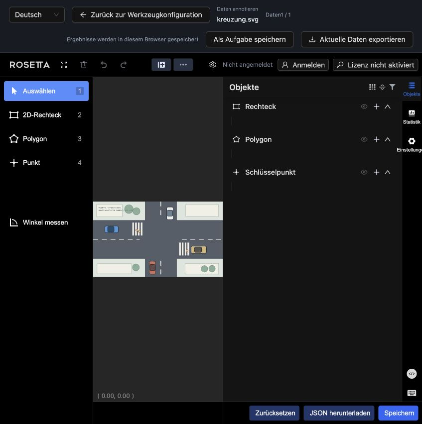
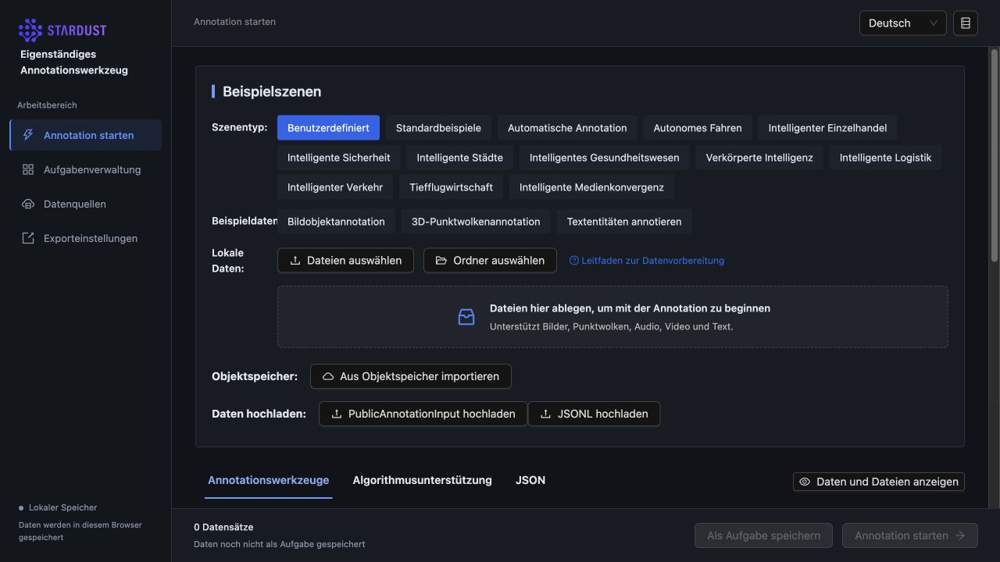
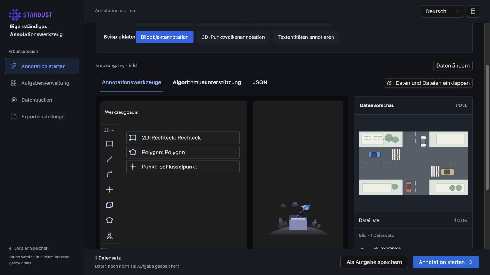
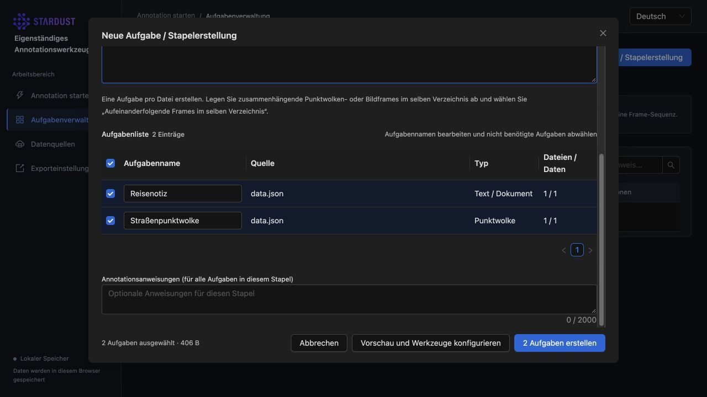
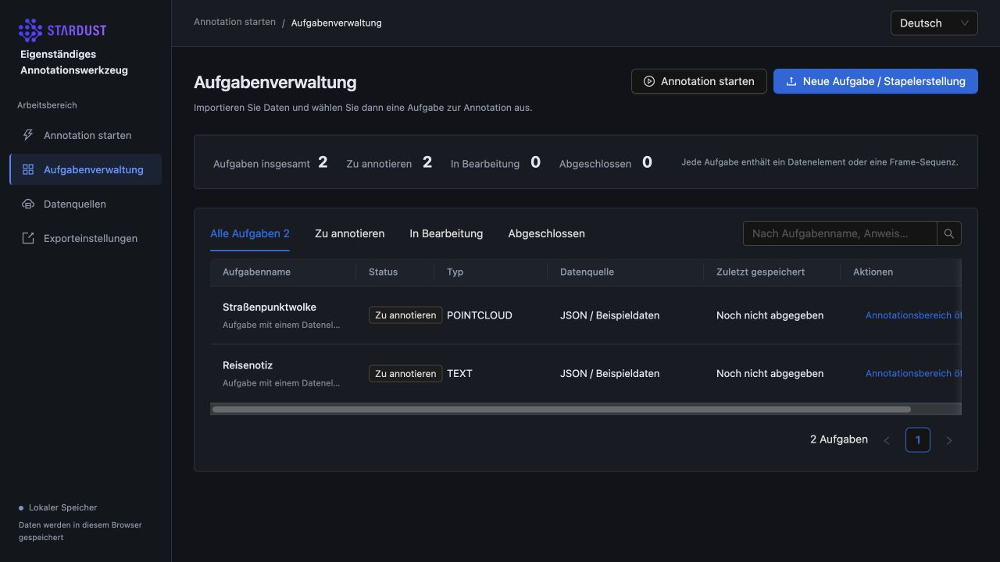
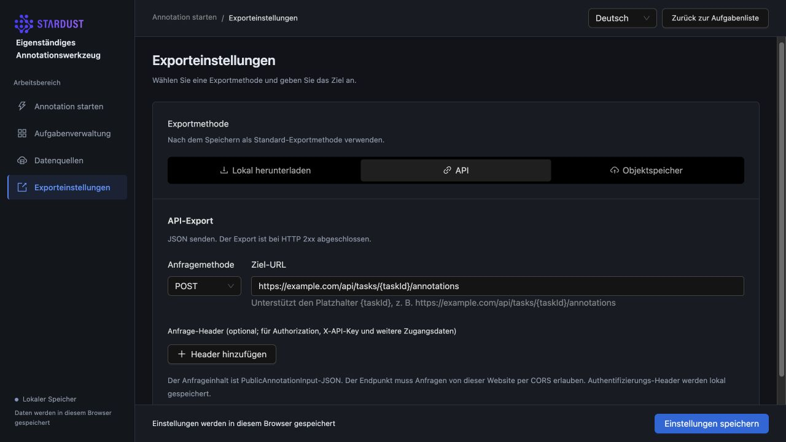
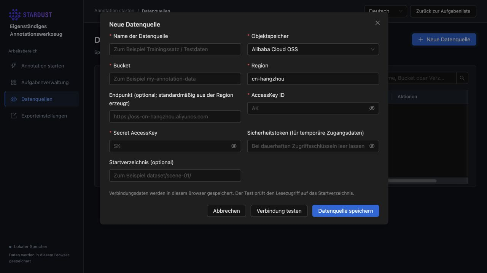

# Rosetta Annotation Tool

[English](README.md) | [简体中文](README.zh-CN.md) | **Deutsch** | [日本語](README.ja-JP.md)

Bilder, Punktwolken, Videos, Audio und Texte im Browser annotieren: Dateien importieren, Labels einrichten, Aufgaben verwalten und gespeicherte Ergebnisse als JSON exportieren.



Aufgaben und lokale Dateien bleiben im Browser. Der Annotationseditor läuft in einem eigenen iframe-Dienst, dessen Adresse die Administration hinterlegt. Ohne diesen Dienst können Sie weiterhin Dateien importieren, Aufgaben verwalten und bereits gespeicherte Daten exportieren.

## Vor dem ersten Start

Verwenden Sie einen aktuellen Desktop-Browser. Bewahren Sie die Originaldateien auf und laden Sie Ihre Ergebnisse nach jeder bearbeiteten Gruppe herunter. Wenn Sie die Website-Daten im Browser löschen, gehen auch die lokalen Aufgaben, Dateien und gespeicherten Verbindungen verloren. Ein anderer Browser hat keinen Zugriff auf diese Daten.

Die Oberfläche startet auf Englisch. Oben rechts können Sie **Deutsch**, **日本語** oder **中文** wählen. Auf der Annotationsseite steht die Auswahl oben links. Der Browser merkt sich die Sprache; der eingebettete Editor übernimmt sie. Eigene Aufgaben- und Labelnamen bleiben unverändert.

## Das mitgelieferte Bild ausprobieren

1. Öffnen Sie **Annotation starten** in der Seitenleiste.
2. Wählen Sie unter **Beispieldaten** die **Bildobjektannotation**. Die Straßenansicht ist enthalten; ein Upload ist nicht nötig.
3. Öffnen Sie **Daten und Dateien anzeigen**, um das Bild und seinen Dateiverweis zu prüfen.
4. Unter **Annotationswerkzeuge** sind Rechteck, Polygon und Schlüsselpunkt bereits eingerichtet. Lassen Sie diese für den ersten Versuch stehen.
5. Mit **Als Aufgabe speichern** auf der Einrichtungsseite können Sie das Beispiel später aus der Aufgabenliste öffnen. Wählen Sie anschließend **Annotation starten**. Erlauben Sie neue Tabs für diese Website, falls der Browser sie blockiert.



**3D-Punktwolkenannotation** und **Textentitäten annotieren** verwenden denselben Ablauf. Die Punktwolke zeigt eine Straßenszene, das Textbeispiel eine kurze Reisenotiz.

## Labels und Werkzeuge einrichten

Die Einrichtungsseite zeigt Werkzeuge und Datenvorschau nebeneinander. Über **Daten und Dateien anzeigen** prüfen Sie, welche Datei Sie gerade konfigurieren.



Wählen Sie ein vorhandenes Annotationselement, um seinen Namen und die ausfüllbaren Felder zu ändern. Mit den Werkzeugen links ergänzen Sie Formen und Attribute. Für Fahrzeuge eignen sich beispielsweise Rechtecke, für einzelne Positionen Punkte. Legen Sie zunächst nur die Labels an, die Sie für diese Aufgabe benötigen.

Bei einer bestehenden Aufgabe öffnen Sie **Aufgabenverwaltung → Aufgabenname → Annotationswerkzeuge konfigurieren**. Änderungen werden dieser Aufgabe zugeordnet.

## Eine Annotation zeichnen und speichern

Im Editor stehen die Werkzeuge links, die Daten in der Mitte und die Objektliste rechts.

Wählen Sie **2D-Rechteck** oder drücken Sie **2** und ziehen Sie einen Rahmen um ein Fahrzeug. Mit **Auswählen** oder **1** wählen und verschieben Sie Objekte. Im Bildbeispiel liegen **Polygon** und **Punkt** auf **3** und **4**. Die Zahlen neben den Werkzeugen zeigen die jeweils gültigen Tastenkürzel.

Klicken Sie unten rechts auf **Speichern**, um das Annotationsergebnis abzulegen. **Als Aufgabe speichern** auf der Einrichtungsseite erstellt eine Aufgabe und ersetzt diesen Speicherschritt im Editor nicht.

Zum Speichern und Exportieren im Editor benötigen Sie eine Anmeldung per E-Mail und eine gültige Lizenz:

1. Geben Sie Ihre E-Mail-Adresse ein und wählen Sie **Bestätigungscode anfordern**.
2. Tragen Sie den sechsstelligen Code aus der E-Mail ein und melden Sie sich an. Dieselbe E-Mail enthält die Lizenz.
3. Nach der Anmeldung wird die Lizenz aktiviert. Falls das nicht geschieht, öffnen Sie den Lizenzeintrag und fügen Sie die Lizenz aus der E-Mail des aktuellen Kontos ein.
4. Wählen Sie im Editor erneut **Speichern**. Prüfen Sie in der Aufgabenliste **Zuletzt gespeichert**, bevor Sie die nächste Aufgabe beginnen.

Zum Ansehen von Daten und Einrichten von Aufgaben ist keine Anmeldung nötig. Die Administration betreibt den E-Mail- und Lizenzdienst getrennt vom Frontend.

## Eigene Dateien importieren

Für einzelne Dateien verwenden Sie **Dateien auswählen** oder **Ordner auswählen** auf der Startseite. Für mehrere Aufgaben öffnen Sie **Aufgabenverwaltung → Neue Aufgabe / Stapelerstellung**.

Im Importfenster:

1. Wählen Sie **Lokale Dateien**, dann **Mehrere Dateien auswählen** oder **Übergeordneten Ordner auswählen**. Sie können Dateien auch in das Fenster ziehen.
2. Für unabhängige Dateien lassen Sie **Eine Aufgabe pro Datei** ausgewählt.
3. Für Bild- oder Punktwolkensequenzen legen Sie die Frames im selben Ordner ab, wählen den übergeordneten Ordner und aktivieren **Aufeinanderfolgende Frames im selben Verzeichnis**. Unterordner werden getrennt verarbeitet.
4. Prüfen Sie die Aufgabennamen und wählen Sie unerwünschte Dateien ab. Gemeinsame Vorgaben können Sie als Annotationsanweisungen eintragen.
5. Erstellen Sie die Aufgaben mit der Schaltfläche unten rechts. Über den Aufgabennamen gelangen Sie zu Details, Werkzeugkonfiguration und Editor.

Unterstützte lokale Dateiendungen:

| Daten              | Dateiendungen                            |
| ------------------ | ---------------------------------------- |
| Bilder             | `.png`, `.jpg`, `.jpeg`, `.bmp`, `.webp` |
| Punktwolken        | `.pcd`, `.ply`                           |
| Audio              | `.mp3`, `.wav`, `.ogg`, `.m4a`           |
| Video              | `.mp4`, `.webm`, `.mov`                  |
| Text und Dokumente | `.txt`, `.md`, `.html`, `.pdf`, `.docx`  |

Auch bei einer unterstützten Endung kann der Browser am verwendeten Codec oder Dokumentinhalt scheitern. Nicht unterstützte, versteckte und leere Dateien erscheinen im Importfenster als übersprungen. Lokale SVG-Uploads werden nicht angenommen; das eingebaute Bildbeispiel verwendet einen mitgelieferten SVG-Verweis.

Für vorhandene `PublicAnnotationInput`-JSON-Dokumente oder `DataRecord`-JSONL-Dateien verwenden Sie den Tab **JSON / JSONL**. Mehrere Datensätze werden in einzelne Aufgaben aufgeteilt. Mitgelieferte Werkzeuge und gespeicherte Ergebnisse bleiben erhalten.



Die Aufnahme zeigt ein `PublicAnnotationInput` mit Verweisen auf die mitgelieferten Text- und Punktwolkendaten. In der Vorschau können Sie Namen ändern und einzelne Aufgaben abwählen.

## In der Aufgabenliste weiterarbeiten



Jede Zeile steht für einen Datensatz oder eine Frame-Sequenz. Das Suchfeld findet Aufgaben anhand von Namen, Anweisungen oder Quelle. Die Tabs filtern den Bearbeitungsstand:

- **Zu annotieren**: Es liegt noch kein bestätigtes Ergebnis vor.
- **In Bearbeitung**: Die Arbeit hat begonnen und ist noch nicht abgeschlossen.
- **Abgeschlossen**: Für die Daten liegt ein bestätigtes gespeichertes Ergebnis vor.

Öffnen Sie den Aufgabennamen für die Details. Im Menü **Aktionen** können Sie Namen und Anweisungen ändern, gespeicherte Daten exportieren oder die Aufgabe löschen. Beim Löschen werden auch ihre Annotationsergebnisse aus diesem Browser entfernt. Exportieren Sie vorher alles, was Sie behalten möchten.

## Gespeicherte Ergebnisse exportieren

Speichern Sie Änderungen zuerst im Editor. Der Aufgabenexport enthält das zuletzt in dieser Aufgabe gespeicherte Ergebnis.

Öffnen Sie **Exporteinstellungen**, wählen Sie ein Ziel und speichern Sie die Einstellungen. Anschließend wählen Sie bei der Aufgabe **Exportieren**, entweder in den Details oder im Menü **Aktionen**.



| Methode             | Benötigte Angaben                                                              | Ergebnis                                                                                     |
| ------------------- | ------------------------------------------------------------------------------ | -------------------------------------------------------------------------------------------- |
| Lokal herunterladen | Kein Ziel erforderlich                                                         | Eine JSON-Datei wird auf Ihr Gerät heruntergeladen.                                          |
| API                 | Vollständige HTTP(S)-URL, POST oder PUT und benötigte Authentifizierungsheader | Die App sendet `PublicAnnotationInput` als JSON. Eine 2xx-Antwort bestätigt die Übertragung. |
| Objektspeicher      | Gespeicherte OSS-, OBS- oder TOS-Datenquelle und Verzeichnispräfix             | Die App lädt Aufgaben-JSON unter einem neuen Dateinamen hoch.                                |

API-Adressen unterstützen `{taskId}`, etwa `https://example.com/api/tasks/{taskId}/annotations`. Fügen Sie bei Bedarf einen `Authorization`-Header hinzu. Der Empfänger muss Anfragen vom Origin dieser Website per CORS erlauben.

Der Export enthält Dateiverweise, Werkzeugkonfiguration und gespeicherte Annotationen. Originalbilder, Punktwolken, Audio und Videos sind nicht enthalten. Bewahren Sie diese Dateien separat auf. Ein `local://`-Verweis zeigt auf den Browser, in dem die Datei importiert wurde. Mit dem JSON allein erhält eine andere Person diese Datei nicht.

## Daten aus einem Objektspeicher lesen

Öffnen Sie **Datenquellen → Neue Datenquelle**.



Wählen Sie OSS, OBS oder TOS und geben Sie Bucket, Region und Zugangsdaten an. Über das Startverzeichnis begrenzen Sie den Bereich, den Sie später durchsuchen. Lassen Sie **Endpoint** leer, wenn der regionale Standard des Anbieters passt. Temporäre Zugangsdaten benötigen zusätzlich ein Sicherheitstoken.

Wählen Sie **Verbindung testen**, dann **Datenquelle speichern**. Im Aufgabenimport wählen Sie **Objektspeicher**, die Verbindung und das Verzeichnis. Mit **Verzeichnis lesen und Liste erstellen** laden Sie die Einträge. Prüfen Sie die Liste vor dem Erstellen der Aufgaben.

Die Zugangsdaten benötigen Berechtigungen zum Auflisten und Lesen. Bucket-CORS muss GET und HEAD vom Arbeitsbereichs- und Annotations-Origin zulassen. Für Exporte sind außerdem PutObject-Berechtigung und PUT vom Arbeitsbereichs-Origin nötig. Gespeicherte Zugangsdaten bleiben in diesem Browser und werden nicht mit den Aufgaben exportiert.

## Das Frontend lokal starten

Installieren Sie Node.js 22.13 oder neuer innerhalb der Reihe 22.x, oder Node.js 24+, sowie [pnpm 12.21.0](https://pnpm.io/installation). Die Paketmanager-Version ist in `package.json` festgelegt.

```sh
git clone https://github.com/stardustai/rosetta.git
cd rosetta
pnpm install --frozen-lockfile
cp .env.example .env.local
pnpm run dev
```

Öffnen Sie [http://127.0.0.1:4174](http://127.0.0.1:4174). Wenn ein Annotationsdienst bereitsteht, tragen Sie seine Adresse in `.env.local` ein:

```dotenv
VITE_ANNOTATION_URL=https://annotation.example.com/
```

Starten Sie den Entwicklungsserver nach einer Änderung der Umgebungsdatei neu. Lokal wird sonst `http://127.0.0.1:4175/` verwendet. Der Dienst an dieser Adresse wird separat installiert und gestartet.

## Auf GitHub Pages veröffentlichen

Der [Pages-Workflow](.github/workflows/pages.yml) prüft Typen, führt Unit- und iframe-Integrationstests aus, baut die App und veröffentlicht erfolgreiche Pushes auf `main`. Pull Requests führen nur die Prüfungen aus. Der Workflow lässt sich auch manuell starten.

1. Wählen Sie unter **Settings → Pages** die Quelle **GitHub Actions**. Die einmalige Freischaltung erfordert Verwaltungsrechte für Pages.
2. Pushen Sie die Änderungen auf `main`.
3. Sobald der Annotationsdienst verfügbar ist, legen Sie die **Actions-Variable** `VITE_ANNOTATION_URL` mit seiner öffentlichen HTTPS-Adresse an und starten den Workflow erneut.
4. Tragen Sie den Origin der Pages-Website in `VITE_HOST_ORIGINS` des Annotationsdienstes ein. Der Repository-Pfad gehört nicht zum Origin.

Das Frontend kann vor dem Annotationsdienst veröffentlicht werden. Bis dessen Adresse eingetragen ist, erscheint anstelle des Editors ein Verbindungshinweis. API und Annotationsdienst werden separat betrieben. Für die E-Mail-Anmeldung im iframe müssen Domains und Cookie-Einstellungen die SameSite-Anforderungen der API erfüllen.

Der Workflow berücksichtigt den Basispfad `/repository/` und direkte Links auf App-Routen. Bei anderen statischen Hosts setzen Sie bei Bedarf `VITE_BASE_PATH` und lassen App-Routen auf `index.html` zurückfallen.

## Wenn etwas nicht funktioniert

| Anzeige oder Verhalten                  | Prüfen                                                                                      |
| --------------------------------------- | ------------------------------------------------------------------------------------------- |
| Annotationsdienst nicht verbunden       | Nach der Bereitstellung `VITE_ANNOTATION_URL` setzen und das Frontend neu bauen.            |
| Verbindungsfehler im Editor             | Dienstadresse, HTTPS und erlaubte Host-Origins kontrollieren.                               |
| Der Annotationstab öffnet sich nicht    | Pop-ups für die Website erlauben und erneut starten.                                        |
| Lokale Datei fehlt                      | Im selben Browser und auf derselben Website neu importieren; gelöschte Browserdaten prüfen. |
| Importliste ist leer                    | Dateiendungen und leere Dateien prüfen.                                                     |
| Zugriff auf Objektspeicher verweigert   | Bucket, Region, Ablauf der Zugangsdaten, Verzeichnisrechte und CORS prüfen.                 |
| Neue Annotationen fehlen im Export      | Erst im Editor speichern, dann die Aufgabe exportieren.                                     |
| E-Mail-Anmeldung im iframe schlägt fehl | Administration um Prüfung von API, SMTP, erlaubten Origins und Cookie-Richtlinien bitten.   |

## Entwicklung

```sh
pnpm run typecheck
pnpm test
pnpm run test:render
pnpm run build
```

Die Ausgabe liegt in `dist/`. Bei laufendem Entwicklungsserver prüft `pnpm run test:server` den Seiteneinstieg und die Beispieldateien.

Die Oberfläche verwendet englische Nachrichtenschlüssel aus `src/messages.ts`; die neuen Sprachkataloge liegen in `src/locales/`. Die [iframe-Dokumentation](docs/iframe-integration.md) beschreibt die anfängliche und laufende Sprachsteuerung. Die iframe-Komponente und der versionierte Datenvertrag liegen in [`src/annotation`](src/annotation/).

Die OBS- und TOS-SDKs verwenden axios 0.35.0 über gezielte Overrides in `pnpm-workspace.yaml`. TOS importiert noch die entfernte Factory `createError`; der Alias in `vite.config.ts` stellt sie mit dem öffentlichen Typ `AxiosError` bereit. Der Transporttest prüft beide echten Browser-SDKs gegen einen lokalen HTTP-Server: signierte Anfragen, Seitennavigation, JSON-Uploads und Zugriffsfehler. Behalten Sie diesen Alias bei axios-Updates bei, bis TOS den alten Import entfernt.

Die Bilder wurden in der laufenden deutschen Oberfläche mit den mitgelieferten Beispieldaten aufgenommen. Aufnahmebedingungen stehen in den [Screenshot-Notizen](docs/images/README.de-DE.md). Verwendete Bibliotheken und Zuständigkeiten beschreibt die [Architekturübersicht](docs/architecture.md).
