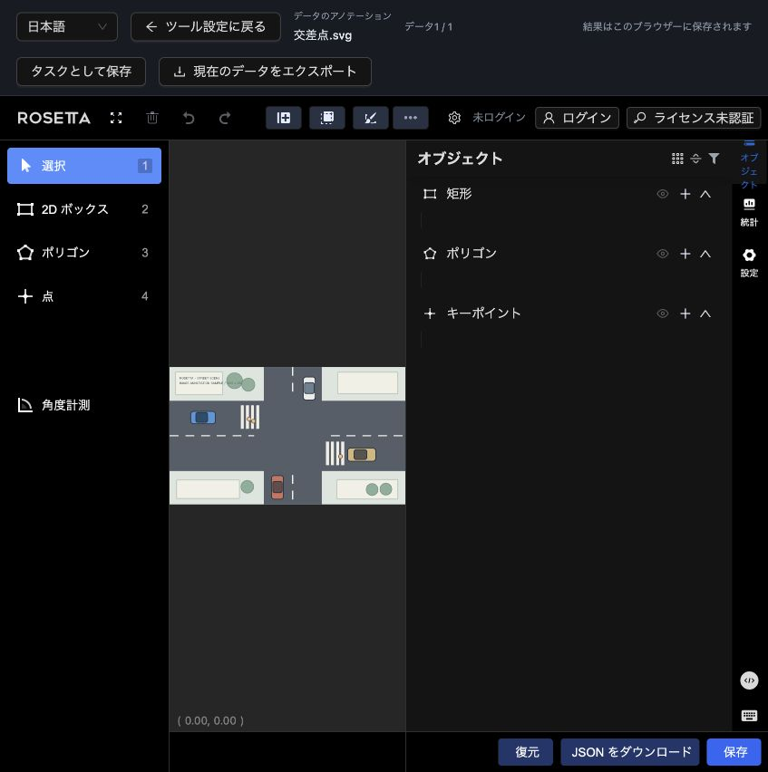
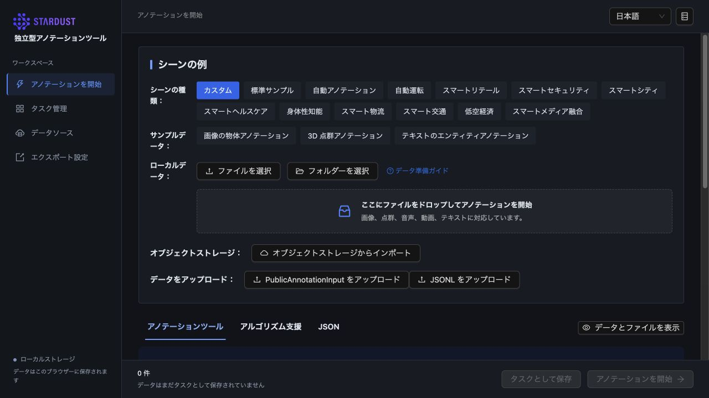
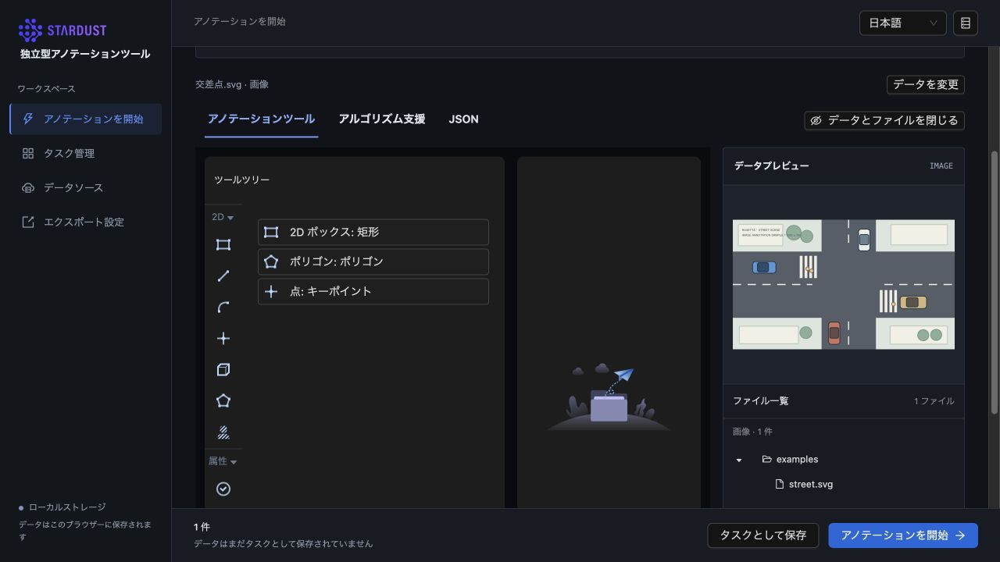
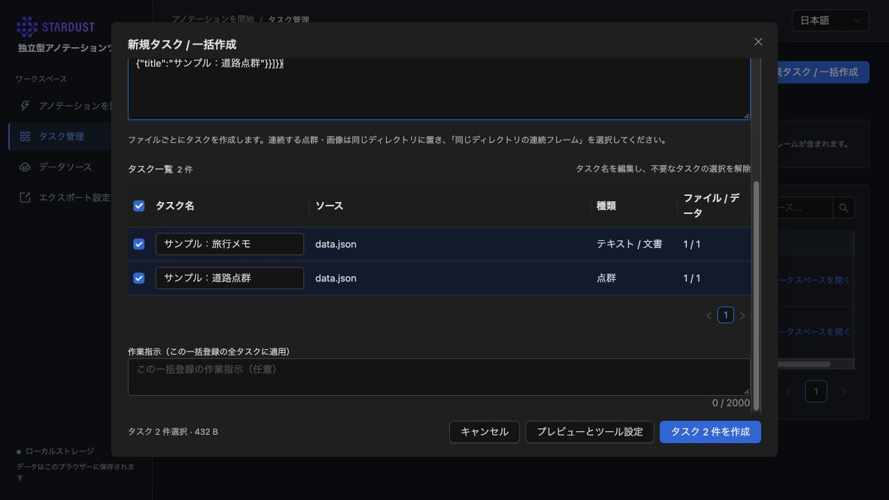
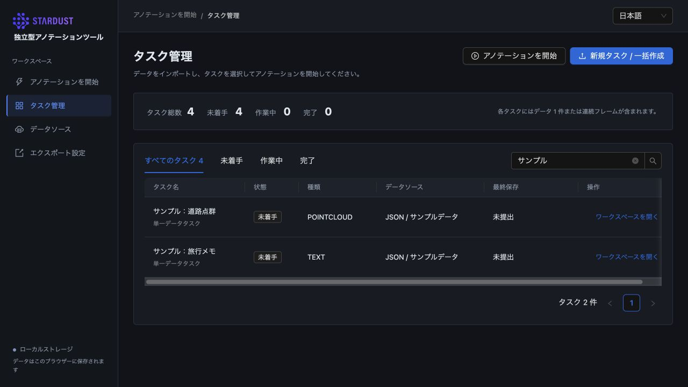
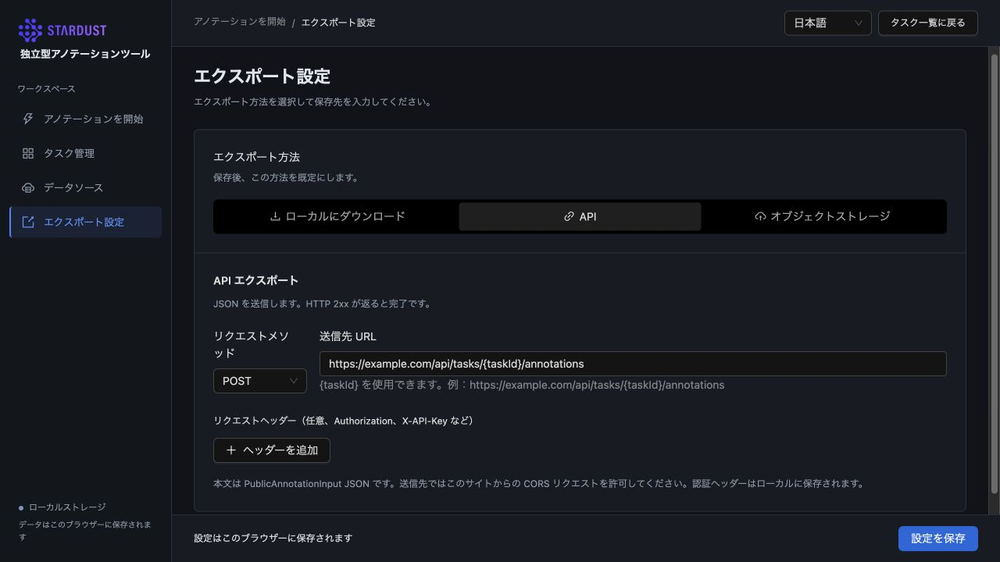
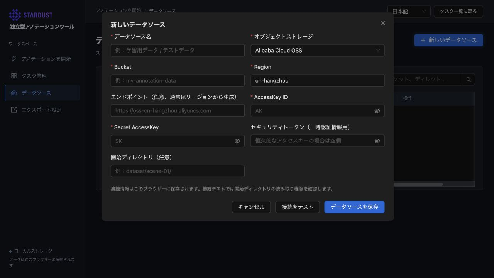

# Rosetta Annotation Tool

[English](README.md) | [简体中文](README.zh-CN.md) | [Deutsch](README.de-DE.md) | **日本語**

画像、点群、動画、音声、テキストをブラウザーでアノテーションするためのツールです。ファイルの読み込み、ラベルの設定、タスクの管理から、保存済み結果の JSON エクスポートまで行えます。



タスクとローカルファイルは、このブラウザーに保存されます。エディターは別の iframe サービスで動作し、その接続先はサイトの管理者が設定します。サービスが未接続でも、ファイルの読み込み、タスク管理、保存済みデータのエクスポートは利用できます。

## はじめに

最新のデスクトップブラウザーを使用してください。元のファイルは別に保管し、一連の作業が終わったら結果をダウンロードしておきます。このサイトのブラウザーデータを削除すると、ローカルのタスク、ファイル、保存した接続情報も削除されます。別のブラウザーを開いても、これらのデータは引き継がれません。

初期表示は英語です。右上の言語選択から **日本語**、**Deutsch**、**中文** に切り替えられます。アノテーション画面では左上にあります。設定はブラウザーに保存され、埋め込みエディターにも反映されます。自分で付けたタスク名やラベル名は、そのまま残ります。

## 付属の画像で試す

1. サイドバーの **アノテーションを開始** を開きます。
2. **サンプルデータ** で **画像の物体アノテーション** を選びます。道路の画像が付属しているので、アップロードは不要です。
3. **データとファイルを表示** を開き、画像とファイルの参照先を確認します。
4. **アノテーションツール** タブには、矩形、ポリゴン、キーポイントが設定されています。初回はそのまま使用します。
5. あとでタスク一覧から開きたい場合は、設定画面の **タスクとして保存** を押してから **アノテーションを開始** を選びます。新しいタブが開かない場合は、このサイトのポップアップを許可してやり直してください。



**3D 点群アノテーション** と **テキストのエンティティアノテーション** も、同じ手順で試せます。点群のサンプルは道路のシーン、テキストは短い旅行の記録です。

## ラベルとツールを設定する

設定画面には、ツール設定とデータプレビューが並んでいます。**データとファイルを表示** を開くと、設定対象のファイルを確認できます。



既存の項目を選ぶと、ラベル名や入力欄を変更できます。左側のツールから、必要な図形や属性を追加します。たとえば車両には矩形、位置の指定には点を使います。まずは今回の作業で使うラベルだけを設定してください。

既存タスクの場合は、**タスク管理 → タスク名 → アノテーションツール設定** から変更します。設定は、そのタスクに保存されます。

## アノテーションを付けて保存する

エディターでは、左側に描画ツール、中央にデータ、右側にオブジェクト一覧が表示されます。

画像サンプルでは **2D ボックス** を選ぶか **2** を押し、車両を矩形で囲みます。**選択** または **1** でオブジェクトを選び、位置や大きさを調整できます。このサンプルの **ポリゴン** と **点** は、それぞれ **3**、**4** です。ツールの横に表示された数字が、現在の設定のショートカットです。

編集後は右下の **保存** を押します。設定画面の **タスクとして保存** はタスクを作成する操作です。エディターで変更したアノテーションは、エディター内の **保存** で書き込みます。

エディターから保存・エクスポートするには、メールでのログインと有効なライセンスが必要です。

1. メールアドレスを入力し、**確認コードを取得** を選びます。
2. 届いたメールに記載された 6 桁のコードを入力してログインします。同じメールにライセンスも含まれます。
3. ログイン後にライセンスが有効になります。有効にならない場合は、ライセンスの項目を開き、現在のアカウント宛てのメールからライセンスを貼り付けてください。
4. エディターに戻り、もう一度 **保存** を押します。タスク一覧の **最終保存** を確認してから次の作業へ進みます。

データの閲覧とタスクの設定にはログインは不要です。メールとライセンスのサービスは、管理者がフロントエンドとは別に運用します。

## 自分のファイルを読み込む

少数のファイルを試すときは、開始画面の **ファイルを選択** または **フォルダーを選択** を使います。複数のデータをタスクとして管理する場合は、**タスク管理 → 新規タスク / 一括作成** を開きます。

読み込み画面では、次の順に操作します。

1. **ローカルファイル** を選び、**複数ファイルを選択** または **親フォルダーを選択** を押します。ファイルを画面へドラッグしても読み込めます。
2. 独立したファイルでは、**1 ファイルにつき 1 タスク** を使用します。
3. 画像や点群の連続フレームでは、フレームを同じフォルダーに入れ、親フォルダーを選択して **同じディレクトリの連続フレーム** に切り替えます。サブフォルダーは個別に処理されます。
4. タスク名を確認し、不要なファイルのチェックを外します。共通の作業要件があれば、作業指示を入力します。
5. 右下のボタンでタスクを作成します。作成後はタスク名から、詳細、ツール設定、エディターを開けます。

ローカルファイルで対応している拡張子は次のとおりです。

| データ         | 拡張子                                   |
| -------------- | ---------------------------------------- |
| 画像           | `.png`、`.jpg`、`.jpeg`、`.bmp`、`.webp` |
| 点群           | `.pcd`、`.ply`                           |
| 音声           | `.mp3`、`.wav`、`.ogg`、`.m4a`           |
| 動画           | `.mp4`、`.webm`、`.mov`                  |
| テキスト・文書 | `.txt`、`.md`、`.html`、`.pdf`、`.docx`  |

対応する拡張子でも、コーデックや文書の内容によってはブラウザーで表示できないことがあります。未対応のファイル、隠しファイル、空のファイルは、読み込み時に除外された項目として表示されます。ローカルの SVG は読み込めません。内蔵の画像サンプルは、アプリに付属する SVG を参照しています。

`PublicAnnotationInput` の JSON や `DataRecord` の JSONL がある場合は、**JSON / JSONL** タブを使います。複数のデータレコードは個別のタスクに分割され、既存のツール設定と保存済み結果は引き継がれます。



図では、付属のテキストと点群を参照する `PublicAnnotationInput` を読み込んでいます。プレビューでタスク名を変更し、不要な項目を外してから作成できます。

## タスク一覧から作業を再開する



各行は 1 件のデータ、または 1 組の連続フレームです。検索欄では、タスク名、作業指示、読み込み元から探せます。上部のタブで進捗を絞り込めます。図では検索欄に「サンプル」を入力し、撮影用の 2 件だけを表示しています。

- **未着手**：確定した提出結果がまだありません。
- **作業中**：作業を開始しており、まだ完了していません。
- **完了**：確認済みの保存結果があります。

タスク名を押すと詳細が開きます。行の **操作** メニューからは、名前・作業指示の編集、保存済みデータのエクスポート、タスクの削除ができます。削除すると、そのタスクのアノテーション結果もブラウザーから削除されます。必要な結果は、先にエクスポートしてください。

## 保存済みの結果をエクスポートする

先にエディターで変更を保存してください。タスクのエクスポートには、そのタスクへ最後に保存した結果が含まれます。

**エクスポート設定** で出力先を選んで保存し、タスクの詳細または **操作** メニューから **エクスポート** を選びます。



| 方法                   | 設定する内容                                                | 動作                                                                       |
| ---------------------- | ----------------------------------------------------------- | -------------------------------------------------------------------------- |
| ローカルにダウンロード | 出力先の指定は不要                                          | JSON ファイルを端末へダウンロードします。                                  |
| API                    | 完全な HTTP(S) URL、POST または PUT、必要な認証ヘッダー     | `PublicAnnotationInput` の JSON を送信し、2xx 応答で送信成功と判定します。 |
| オブジェクトストレージ | 保存済みの OSS・OBS・TOS データソースとディレクトリの接頭辞 | 新しいファイル名でタスクの JSON をアップロードします。                     |

API の URL では `{taskId}` を使えます。例：`https://example.com/api/tasks/{taskId}/annotations`。必要に応じて `Authorization` などのヘッダーを指定します。受信側では、このサイトの Origin からのリクエストを CORS で許可してください。

エクスポートされるのは、ファイルの参照先、ツール設定、保存済みアノテーションです。元の画像、点群、音声、動画は含まれません。元のファイルは別に保管してください。`local://` は読み込みを行ったブラウザーの保存領域を指します。JSON を他の人に渡しても、そのファイルは一緒に渡りません。

## オブジェクトストレージのデータを使う

**データソース → 新しいデータソース** を開きます。



OSS、OBS、TOS のいずれかを選び、Bucket、Region、アクセス用の認証情報を入力します。開始ディレクトリで、後から参照する範囲を指定できます。サービスの標準のリージョン別アドレスを使う場合は、**Endpoint** を空欄にします。一時認証情報を使う場合は、セキュリティトークンも必要です。

**接続をテスト**、**データソースを保存** の順に操作します。タスクの読み込み画面で **オブジェクトストレージ** を選び、接続とディレクトリを指定して **ディレクトリを読み取って一覧作成** を押します。表示された一覧を確認してからタスクを作成します。

認証情報には一覧取得と読み取りの権限が必要です。Bucket の CORS では、ワークスペースとアノテーション画面の Origin からの GET、HEAD を許可します。Bucket へのエクスポートには、PutObject 権限とワークスペースの Origin からの PUT も必要です。保存した認証情報はこのブラウザーに残り、タスクのエクスポートには含まれません。

## フロントエンドをローカルで起動する

Node.js 22.13 以降の 22.x、または Node.js 24 以降と、[pnpm 12.21.0](https://pnpm.io/installation) を用意します。パッケージマネージャーのバージョンは `package.json` で固定されています。

```sh
git clone https://github.com/stardustai/rosetta.git
cd rosetta
pnpm install --frozen-lockfile
cp .env.example .env.local
pnpm run dev
```

[http://127.0.0.1:4174](http://127.0.0.1:4174) を開きます。アノテーションサービスがある場合は、`.env.local` に接続先を設定してください。

```dotenv
VITE_ANNOTATION_URL=https://annotation.example.com/
```

環境ファイルを変更したら、開発サーバーを再起動します。ローカル開発時の既定の接続先は `http://127.0.0.1:4175/` です。このポートのサービスは、別途インストールして起動します。

## GitHub Pages に公開する

[Pages ワークフロー](.github/workflows/pages.yml) は、型チェック、ユニットテスト、iframe の統合テスト、ビルドを行い、`main` に push した版を公開します。Pull Request ではチェックのみ行います。Actions から手動での実行も可能です。

1. リポジトリの **Settings → Pages** で、公開元を **GitHub Actions** にします。初回の有効化には Pages の管理権限が必要です。
2. 変更を `main` に push します。
3. アノテーションサービスの用意ができたら、リポジトリの **Actions variables** に `VITE_ANNOTATION_URL` を追加し、公開 HTTPS アドレスを設定してワークフローを再実行します。
4. Pages サイトの Origin を、アノテーションサービスの `VITE_HOST_ORIGINS` に追加します。Origin にリポジトリのパスは含めません。

フロントエンドだけを先に公開しても構いません。サービスのアドレスが未設定の間は、エディターの代わりに接続案内が表示されます。API とアノテーションサービスは別途配置します。iframe でメールログインを使う場合は、API の SameSite 要件に合うドメインと Cookie の設定が必要です。

ワークフローは `/リポジトリ名/` のパスと、アプリ内の直接リンクを処理します。別の静的ホストを使う場合は、必要に応じて `VITE_BASE_PATH` を設定し、アプリのルートを `index.html` にフォールバックさせてください。

## うまく動かないとき

| 状況                               | 確認すること                                                                         |
| ---------------------------------- | ------------------------------------------------------------------------------------ |
| アノテーションサービスが未接続     | サービスを配置後、`VITE_ANNOTATION_URL` を設定してフロントエンドを再ビルドします。   |
| エディター内に接続エラーが出る     | サービスの URL、HTTPS、許可したホストの Origin を確認します。                        |
| アノテーション用のタブが開かない   | サイトのポップアップを許可して再試行します。                                         |
| ローカルファイルが見つからない     | 元のブラウザー・サイトで読み込み直し、ブラウザーデータを削除していないか確認します。 |
| 読み込み一覧が空になる             | 対応する拡張子か、空のファイルでないかを確認します。                                 |
| ストレージへのアクセスが拒否される | Bucket、Region、認証情報の有効期限、ディレクトリの権限、CORS を確認します。          |
| エクスポートに最新の変更がない     | エディターで保存してから、タスクをエクスポートします。                               |
| iframe のメールログインに失敗する  | 管理者に API、SMTP、許可した Origin、Cookie ポリシーの確認を依頼します。             |

## 開発時の確認

```sh
pnpm run typecheck
pnpm test
pnpm run test:render
pnpm run build
```

出力先は `dist/` です。開発サーバーが動作していれば、`pnpm run test:server` でページの入口とサンプルファイルを確認できます。

UI の翻訳キーは `src/messages.ts` の英文です。追加の言語カタログは `src/locales/` にあります。[iframe の接続ガイド](docs/iframe-integration.md) で、初期言語と実行中の切り替えを説明しています。iframe コンポーネントとバージョン付きのデータ定義は [`src/annotation`](src/annotation/) にあります。

OBS と TOS の SDK は、`pnpm-workspace.yaml` の対象を限定した overrides により axios 0.35.0 を使います。TOS は削除済みの `createError` をまだ import するため、`vite.config.ts` の alias が公開型 `AxiosError` を使って補っています。ストレージの転送テストでは、両社の実際のブラウザー SDK をローカル HTTP サーバーへ接続し、署名付きリクエスト、ページング、JSON のアップロード、権限エラーを確認します。TOS 側で古い import がなくなるまで、axios 更新時もこの alias を残してください。

本書の画像は、付属のサンプルデータを使い、日本語に切り替えた実際の画面から撮影しました。撮影条件は[スクリーンショットについて](docs/images/README.ja-JP.md)、開発ライブラリーと処理の分担は[構成ガイド](docs/architecture.md)を参照してください。
